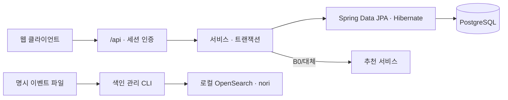

<div align="center">
  
  <h1>주점부리 · Backend</h1>
  <p><strong>취향에 맞는 한 잔을 발견하고 기록하는 주류 큐레이션</strong></p>
  <p>회원·상품·후기·데모 주문을 제공하는 Spring Boot API</p>
  <a href="https://github.com/Pubburi/Backend/actions/workflows/ci.yml"></a>
    
</div>

<br />

## 📄 목차

- [프로젝트 개요](#overview)
- [현재 기능과 범위](#features)
- [기술 스택](#technology)
- [시스템 구조](#architecture)
- [문제 해결](#problem-solving)
- [로컬 실행](#development)
- [검증과 협업](#verification)
- [개발 계획](#roadmap)

<br />

<a id="overview"></a>

## ✍ 프로젝트 개요

주류 탐색·후기·데모 주문과 관리자 기능을 제공하는 공통 API입니다. Java 17·Spring Boot·Spring Data JPA·PostgreSQL을 기본 산출물로 제공하며 세션 인증을 사용합니다. 이관 전 MySQL/MyBatis는 명시 baseline으로 보존합니다.

<a id="features"></a>

## 🥃 현재 기능과 범위

| 영역 | 현재 제공 기능 |
|---|---|
| 회원 | 회원가입, 세션 로그인·로그아웃, 본인 이름·현재 암호 확인 후 비밀번호 변경, 현재 계정·역할 기반 접근 제어, 삭제·비밀번호 변경 세션 회수 |
| 명시취향 | 본인 전용 조회·전체 교체 API, 설문 상태·미입력/빈 선호·soft 목표/hard 범위 구분 |
| 계정 찜 | 본인 전용 저장·해제·단건 상태·페이지 API, 반복 요청 멱등성·현재 상품 정보·삭제/재가입 격리 |
| 비공개 기록 | PG의 본인 전용 TRIED/INTERESTED·선택 평점·맛/향·메모 CRUD, 원문·삭제 상품 기록 보존·동시 수정 충돌 검수 |
| 계정 카트 | PG의 기기 간 보관·절대 수량/삭제·명시 비회원 병합, revision·UUID receipt로 동시 수정과 중복 합산/주문 방지 |
| 기본 주류 목록 | 비개인 ID순 B0 연결, 전체 응답 대기·크기 제한, 현재 DB 재조회와 장애 대체 |
| 본인 B1 추천 | 검수 로컬 catalog·현재 본인 취향/활동·맞음/관심 없음, 카트/데모 주문의 사실 맥락, 필수조건을 지키는 상품군 탐색 |
| 검색 문구 API | 본인 현재 취향·별도 검색 선택의 정확 조건 호출, 필수조건/수명 검증과 제공 불가 구분. 검색 화면 연결 제공 |
| 상품 | 목록·이름/주종 검색, 가격·도수·명시 맛/향 AND 필터·정렬·페이지 이동, 상세·유사 상품과 선택 비교 이유·인기 상품 |
| 상품 특성 | 별도 조회·관리자 전체 교체 API, 용량·설명·맛/향 태그·출처, 미확인/검수된 빈 태그 구분 |
| 색인 관리 | 업무 트랜잭션의 상품 버전·변경 기록과 전송 예약, 별도 실행 relay의 claim/ack·재전달, 선택적 로컬 OpenSearch·nori와 삭제 표식. 명시 공개 검색·현재 DB 대조와 필수조건 대체 |
| 후기 | 상품별 평점·후기 조회와 작성·수정·삭제 |
| 데모 주문 | 주문 생성·내역·상세, 주문 시점 상품/가격 스냅샷·총액, 상품·회원 삭제 후 이력 보존, 관리자 완료 처리·스탬프 |
| 관리자 | 상품·회원·후기·매장·주문 관리 |

현재 인기 상품은 누적 주문 수 정렬이며 기본 추천 목록은 별도 ID순입니다. 검수 로컬 추천의 가격은 시연 값이고 업무행 존재가 판매/재고 확인을 뜻하지 않습니다.
API와 응답 계약은 [API Map](docs/API-MAP.md)을 참고하세요.

<a id="technology"></a>

## ⚙️ 기술 스택

| 분류 | 기술 스택 |
|---|---|
| 언어 | Java · Python |
| 프레임워크·라이브러리 | Spring Boot · Bean Validation · Jackson |
| 서버 | Tomcat |
| 데이터베이스 | MySQL · PostgreSQL |
| 데이터 접근 | MyBatis · Spring Data JPA · Hibernate · PyMySQL · Psycopg |
| DB 마이그레이션 | Flyway |
| 검색 | OpenSearch · analysis-nori |
| API 문서 | springdoc · OpenAPI · Swagger UI |
| 빌드 | Maven Wrapper |
| 테스트 | JUnit |
| CI | GitHub Actions |

<a id="architecture"></a>

## 🏛️ 시스템 구조

기본 Maven JAR은 PostgreSQL/JPA입니다. 기존 MySQL/MyBatis는 명시 비교 빌드로 보존하며, 실제 DB 선택과 전체 cutover 인수는 별도입니다.



로컬 색인 기동·재생과 미완료 범위는 [실행 안내](docs/LOCAL-SEARCH.md)를 따릅니다. 상품 검색은 선택한 PostgreSQL 또는 명시 MySQL baseline을 사용합니다.

PostgreSQL의 독립 Flyway 스키마·[읽기 전용 원본 추출](docs/SOURCE-SNAPSHOT.md)·[승인 자료의 빈 대상 복사/검증](docs/SOURCE-IMPORT.md)을 제공합니다. 기존 업무 값·명시 ID·원문 JSON 보존과 전체 전환 범위는 [전환 계약](docs/POSTGRESQL-MIGRATION.md)을 따릅니다.
기본 [JPA 제공자](docs/JPA-REHEARSAL.md)는 회원·세션/프로필, 매장·상품/특성, 후기·본인 찜/명시취향·비공개 기록, 기본 목록·데모 주문을 제공합니다.

별도 [명시 relay](docs/SEARCH-RELAY.md)는 MySQL/PostgreSQL을 선택해 같은 Engine/CLI와 검증 TLS·개별 claim/ACK로 전달합니다.
[공개 상품 검색](docs/PRODUCT-SEARCH.md)은 명시적으로 엔진을 읽고 현재 DB의 페이지/total과 대조하며, 누락·지연·장애에는 같은 필수조건의 현재 DB 응답을 반환합니다. 기본은 비활성이며 DB 확인 쿼리를 유지합니다. 자동완성/검색 품질·성능 인수는 후속입니다.

<a id="problem-solving"></a>
<a id="case-studies"></a>

## 🧩 문제 해결

업무와 검색의 상태 경계·입력 정규화·세션의 계정 수명·주문 이력 보존에서 내린 판단을 정리했습니다.
아래 결과는 현재 구현의 동작 범위이며, 응답 시간·처리량의 전후 개선 수치는 아직 측정하지 않았습니다.

### 1. 상품 변경 기록의 원자성부터 검색 엔진 재전달까지 연결하기

#### 문제

검색 색인을 준비하면서 상품만 바뀌고 전달할 기록은 없는 틈, 삭제 뒤 오래된 갱신이 상품을 부활시키는 조건을 다뤄야 했습니다. 과거 운영 장애를 주장하는 사례가 아니라, 실제 업무 쓰기에 재생 가능한 변경 기록을 연결한 설계 사례입니다.

#### 원인

현재 구성에서 MySQL commit과 별도 엔진 HTTP 전송은 같은 DB 트랜잭션이 아닙니다. 상품 행과 함께 버전까지 삭제하면 뒤늦은 입력의 순서를 판단할 기준도 잃습니다. 전역 auto-increment ID 역시 서로 다른 상품의 commit 순서를 뜻하지 않습니다.

#### 해결

생성·수정·특성 교체·주문 수 증가·삭제를 기존 업무 트랜잭션 안의 MANDATORY producer에 연결했습니다. 현재 상품·특성을 잠금 조회한 뒤 영속 상품별 버전·불변 투영·PENDING 예약을 함께 기록합니다. 별도 relay는 짧은 DB claim을 commit한 뒤 엔진에 보내고, DB 시각 lease와 token이 유효할 때만 ACK합니다. 삭제는 영속 tombstone으로 남기며 엔진 전송 중 업무 잠금을 유지하지 않습니다.

#### 결과

상품 변경과 전송 예약은 함께 commit·rollback되고, 명시 실행한 relay는 중단 뒤 남은 미전달 작업을 다시 처리합니다. 중복·순서 역전은 상품별 버전과 엔진 정본으로 판정하며, source·target 식별이 달라지면 ACK하지 않습니다. 이 동작을 공개 검색 전환이나 색인 유실의 자동 복구로 확대하지 않습니다. 생산 근거와 relay의 상세 근거·한계는 별도 기록에 보존했습니다.

#### 대체안/회고

afterCommit 전달은 기록 유실 틈을 남기고, 업무 안의 엔진 전송은 장애와 잠금 시간을 결합하므로 선택하지 않았습니다. 전송은 at-least-once이며 중복은 버전/정본으로 판정합니다. source·물리 색인 UUID를 묶어 다른 target을 조용히 채택하지 않지만 DB와 엔진을 분산 트랜잭션으로 묶는 것은 아닙니다. 추가 조회·DB 쓰기·보관·재전달 비용이 있고 지연은 미측정입니다. 재색인/유실 복구·정리 정책과 공개 검색은 후속이며 event ID를 완료 watermark로 쓰지 않습니다.

#### 코드

```java
if (outbox.append(productId, version, deleted, json.writeValueAsString(event)) != 1)
    throw new IllegalStateException("Search outbox event could not be recorded");
if (outbox.schedule(productId, version) != 1)
    throw new IllegalStateException("Search delivery could not be scheduled");
```

```python
def ack(self, claim):
    with self.transaction() as cursor:
        self.fence_target(cursor, claim.fingerprint, claim.source_id)
        cursor.execute("""UPDATE t_product_search_delivery SET status='DELIVERED', delivered_at=NOW(6),
            claim_token=NULL, lease_until=NULL, last_error=NULL
            WHERE event_id=%s AND status='IN_FLIGHT' AND claim_token=%s AND lease_until>NOW(6)""",
            (claim.event_id, claim.token))
        return cursor.rowcount == 1
```


### 2. 같은 ID 재가입과 권한 변경에서 기존 세션을 구분하기

#### 문제

관리자 권한을 내리거나 계정을 삭제해도 기존 쿠키는 계속 인증됐습니다. 삭제 중 사용하지 않은 쿠키는 같은 ID로 재가입한 새 계정의 프로필에도 접근했습니다.

#### 원인

Guard가 로그인 때의 역할·이름·스탬프를 신뢰했습니다. ID만 DB에서 재확인해도 삭제 후 같은 문자열 ID로 만든 계정은 구분하지 못합니다. 본인 정보 수정 뒤 계정을 다시 읽어 세션을 갱신하는 방법도 다른 관리자가 그 사이 바꾼 자격을 구세션에 부여할 수 있었습니다.

#### 해결

가입마다 내부 `auth_epoch`를 만들고 명시적 비밀번호 변경 때 회전합니다. 보호 요청은 ID와 epoch가 모두 일치하는 현재 계정을 조회해 역할·표시 정보를 사용합니다. 본인 비밀번호 수정은 잠금 안에서 캡처한 변경 전·후 버전만 반환하고, 관측한 세션이 변경 전 버전과 같을 때만 그 수정이 만든 버전으로 갱신합니다. 일반 정보 수정은 세션 버전을 갱신하지 않습니다.

#### 결과

동일 조건의 로컬 MySQL 8.4·실제 HTTP에서 권한 강등 후 관리자 API 허용, 삭제 후 인증, 같은 ID 재가입 후 구쿠키 접근, 비밀번호 변경 후 구세션 인증이 **각각 1/1→0/1**로 바뀌었습니다. 강등은 403, 나머지는 401이며 새 계정 로그인은 유지합니다. 별도 이름/스탬프 시나리오의 오래된 표시도 1/1→0/1입니다. 서로 다른 각 1회 시나리오의 정확성 결과로, 실사용자 오류율·성능 수치는 아닙니다. 원값·조건·전환 근거를 분리해 기록했습니다.

#### 대체안/회고

서버의 모든 세션을 찾아 지우는 방법은 계정별 세션 색인과 수명 관리가 필요합니다. 현재는 계정 행의 버전과 요청 시점 DB 확인을 선택했습니다. 대신 Guard마다 DB 읽기 비용이 들고 이미 인증 검사를 통과한 요청 전체를 취소하지는 않습니다. DB 실패에는 저장된 권한으로 허용하거나 세션을 지우지 않습니다. 분산 세션·전체 동시성·지연 측정은 남아 있으며, 해시 형식만 바꾸는 재해시는 자격 회전과 구분합니다.

#### 코드

```java
User current = userDao.selectSessionIdentity(observed.id(), observed.authEpoch());
if (!sameIdentity(value(session), observed)) {
	return null;
}
```

```java
synchronized (session) {
	if (sameIdentity(value(session), observed)) {
		if (!java.util.Objects.equals(updated.id(), observed.id())
				|| !java.util.Objects.equals(updated.previousAuthEpoch(), observed.authEpoch())) {
			session.removeAttribute(SESSION_USER);
		} else {
			session.setAttribute(SESSION_USER, new SessionUser(observed.id(), observed.name(),
					observed.stamps(), observed.role(), updated.authEpoch()));
		}
	}
}
```


### 3. 응답을 잃어도 장바구니와 주문의 중복 변경 막기

#### 문제

로그인 장바구니 병합·주문을 설계하면서 응답 유실 뒤 같은 작업을 다시 시도하는 상황을 재현했습니다. 처리 기록 조회가 404인 직후 원래 요청이 완료되고, 새 요청 번호로 다시 병합하면 수량이 2개에서 4개가 됐습니다. 개발 중 통제한 재현이며 과거 운영 장애는 아닙니다.

#### 원인

404는 조회 순간 기록이 없다는 뜻이며 대기 중인 요청까지 취소하지 않습니다. 장바구니 revision만 확인해도 새 요청이 최신 값을 읽으면 중복 합산됩니다. 실제 주문 검증에서는 기존 DAO의 bulk SQL 뒤 `EntityManager.clear()`가 장바구니 엔티티를 분리해, 주문은 저장됐지만 남은 수량·revision이 반영되지 않는 별도 결함도 발견했습니다.

#### 해결

계정 행 잠금 안에서 UUID·요청 내용 hash에 결속한 처리 기록을 revision보다 먼저 확인합니다. 결과가 불확실하면 명시적 확인 요청이 이미 적용된 `APPLIED`를 반환하거나, 미적용 UUID를 `RETIRED`로 영속 폐기해 뒤늦은 실행을 차단합니다. 주문·제출 수량 차감·처리 기록은 같은 트랜잭션에 두고, 주문 SQL 뒤에는 장바구니를 다시 잠금 조회해 관리 상태의 엔티티를 변경합니다.

#### 결과

소유 PG18.6·실제 HTTP에서 폐기가 먼저 확정된 요청은 나중에 도착해도 409이며 수량·주문을 추가하지 않았습니다. 원래 실행이 먼저 끝나면 저장한 결과를 재사용했습니다. 주문 완료 뒤 응답만 잃는 상황에서도 주문은 하나이고, 3개 중 2개 주문 뒤 잔량은 1개였습니다. 처리 기록 저장에 실패하면 주문·차감·revision이 함께 rollback됐고, 백업 복구·JAR 재시작 뒤에도 폐기 상태가 유지됐습니다. 정확성 결과이며 서비스 성능이나 실사용자 오류율 수치는 아닙니다.

#### 대체안/회고

버튼 비활성화는 다른 기기와 재시도를 막지 못하고, 주문과 카트 삭제를 별도 HTTP로 나누면 중간 실패가 남습니다. 명시적 결과 확인과 같은 DB 트랜잭션을 선택했습니다. 대신 한 계정의 쓰기가 직렬화되고 처리 기록은 계정 수명 동안 보관됩니다. 미확정 상태에서 새 UUID로 자동 보상하지 않으며, 비회원 원본은 적용 확인 전까지 보존합니다.

#### 코드

```java
@Transactional(isolation=Isolation.READ_COMMITTED)
public Result resolve(SessionUser owner, UUID operation, CartInput.Resolve input) {
    lockOwner(owner);
    String hash = CartInput.intent(input.items(), input.orderType(), input.orderTable());
    var receipt = matching(owner, operation, input.kind(), hash);
    if (receipt != null)
        return new Result(operation, true, receipt.status(),
            view(owner.id(), carts.findById(owner.id()).orElseThrow()), receipt.orderId());
    var cart = locked(owner);
    expected(cart, cart.version());
    advance(cart);
    operations.saveAndFlush(JpaCartOperation.retire(owner.id(), operation, input.kind(), hash));
    return new Result(operation, false, Status.RETIRED, view(owner.id(), cart), null);
}
```


### 4. 가격 변경·참조 삭제에서 주문 이력을 분리하기

#### 문제

주문이 끝난 뒤 상품 가격을 바꾸면 과거 금액이 달라졌고, 상품·회원 삭제는 상세나 주문 자체를 지웠습니다. 활성 상품/계정의 수명이 이미 만들어진 주문 기록까지 바꾸는 문제였습니다.

#### 원인

가격은 현재 상품 JOIN에, 행 생존은 상품·회원 FK의 CASCADE에 묶여 있었습니다. 가격 스냅샷만 추가해도 FK가 상세 행을 지우면 표현/수량이 사라집니다. 계정을 계속 남기는 방식은 이름·자격정보 보관과 모든 조회의 삭제 상태 처리를 요구합니다.

#### 해결

트랜잭션 안에서 상품을 FOR UPDATE로 잠금 조회하고 서버의 상품명·단가·수량별 합계와 주문 총액을 저장합니다. 이후 단건/목록 조회는 저장한 스냅샷을 읽습니다. 새 주문은 ORDER_SNAPSHOT, 과거 단가를 복구할 수 없어 전환 시 고정한 추정값은 LEGACY_ESTIMATE로 구분합니다. 상품·회원 FK는 nullable/SET NULL로 바꿔 참조만 끊고 주문을 보존합니다. 회원 삭제는 회원 잠금→자유 입력 메모 정리→계정 삭제 순서로 처리하며 null 소유자 주문은 관리자만 조회합니다.

#### 결과

가격 변경 실험의 금액 불변 위반은 **3/3 → 0/3**이었습니다. 별도로 같은 초기 데이터의 세 주문에 상품 삭제→회원 삭제를 적용하자 상세 보존 위반은 **2/3 → 0/3**, 회원 삭제 뒤 주문 유실은 **3/3 → 0/3**으로 바뀌었습니다. 삭제 후에도 66,000/217,800/178,200원의 금액과 상세가 남고 참조는 null이 됩니다. 이는 로컬 데모의 정확성 결과이며 실사용자 장애율·응답 성능 수치가 아닙니다. 가격 원값과 삭제 흐름의 분모·원값·재현을 구분해 기록했습니다.

#### 대체안/회고

주문 스냅샷과 nullable FK로 업무 기록을 활성 참조에서 분리하고 회원 이름/비밀번호를 복제하지 않았습니다. 과거 가격은 추정임을 명시합니다. FK 전환에서 실제 MySQL 1826 오류를 만나 동일 ALTER의 제거/추가를 분리했고, 쓰기 중단·백업·중간 상태 확인이 필요해졌습니다. 상품별 가격 SELECT와 회원 삭제 잠금의 비용은 미측정이며 전체 동시성 검증이 남아 있습니다. 삭제 계정 세션의 회수는 두 번째 사례의 별도 인증 경계로 처리합니다. 이미 삭제된 행을 복원한 결과로 확대하지 않습니다.

#### 코드

서비스의 트랜잭션 안에서 가격을 캡처하고 저장하는 부분입니다.

```java
detail.setUnitPrice(product.getPrice());
try {
	detail.setSumPrice(Math.multiplyExact(product.getPrice(), detail.getQuantity()));
	totalPrice = Math.addExact(totalPrice, detail.getSumPrice());
	totalQuantity = Math.addExact(totalQuantity, detail.getQuantity());
} catch (ArithmeticException ex) {
	throw new IllegalArgumentException("Order amount or quantity is out of range", ex);
}
```

상품 삭제 후에도 주문 상세를 남기는 FK 경계입니다.

```sql
ALTER TABLE t_order_detail
    MODIFY COLUMN product_id INT NULL,
    ADD CONSTRAINT fk_order_history_product FOREIGN KEY (product_id)
        REFERENCES t_product(id) ON DELETE SET NULL;
```


<a id="development"></a>

## 🚀 로컬 실행

Java 17과 Docker Compose가 필요합니다. 레포 루트의 `./mvnw verify`는 기본 PostgreSQL JAR을 만들며 기존 DB를 준비하거나 전환하지 않습니다.
MySQL 비교 산출물은 `./mvnw -f tools/mysql-baseline/pom.xml verify`로 별도 빌드합니다.
기존 DB는 [주문 가격 스냅샷 전환](docs/ORDER-PRICE-SNAPSHOT.md)부터 필요한 선행 전환과
[007 검색 변경 기록 전환](docs/SEARCH-OUTBOX.md)과 [008 전송 예약 전환](docs/SEARCH-RELAY.md)을
순서대로 확인하세요. 초기화 SQL을 다시 실행하지 않습니다.

웹·추천 서버까지 함께 실행하려면 [로컬 통합 실행](docs/LOCAL-DEVELOPMENT.md)을 따릅니다. AWS 계정이나 외부 AI 키 없이 사용할 수 있습니다.

```bash
./scripts/local-stack.sh init
./scripts/local-stack.sh install
./scripts/local-stack.sh up
```

검증한 PostgreSQL을 [로컬 대상으로 선택](docs/LOCAL-DEVELOPMENT.md)했다면 `./scripts/dev.sh`로 Backend만 실행합니다.
선택 전 기본 개발 실행과 명시 MySQL 비교에는 아래 설정을 사용합니다.

macOS에서 여러 JDK를 사용하는 경우 먼저 export JAVA_HOME=$(/usr/libexec/java_home -v 17)로 Java 17을 선택합니다.

```bash
cp .env.example .env
# .env의 빈 DB 항목을 본인 로컬 값으로 채웁니다.
docker compose up -d db
./scripts/dev.sh --provider mysql
```

- 기본 서버: http://localhost:9987
- 상품 API: http://localhost:9987/api/products
- Swagger UI: http://localhost:9987/docs
- 필요한 환경변수: PUBBURI_DB_NAME, PUBBURI_DB_USER, PUBBURI_DB_PASSWORD, PUBBURI_DB_ROOT_PASSWORD, PUBBURI_DB_URL.
- PUBBURI_DB_URL에는 로컬 DB와 포트에 맞는 JDBC 접속 문자열을 설정합니다. 비밀번호와 접속 정보는 커밋하지 않습니다.
- 선택 항목: PUBBURI_DB_PORT(기본 3306), PUBBURI_SERVER_PORT(기본 9987), PUBBURI_LOG_LEVEL(기본 INFO).
- SQL은 빈 볼륨에서 처음 DB를 만들 때만 초기화됩니다. 기존 볼륨은 자동으로 다시 초기화하지 않습니다.

종료할 때는 docker compose down을 사용합니다. 일반 종료에서 DB 볼륨은 보존됩니다.

<a id="verification"></a>

## ✅ 검증과 협업

```bash
./scripts/check.sh
```

검증 명령과 폐기용 DB의 HTTP 검사 절차는 [테스트·CI 안내](docs/TESTING.md), 실행 환경은 [로컬 개발 문서](docs/LOCAL-DEVELOPMENT.md)를 따릅니다. 실행 결과와 회귀 근거는 작업 계획·PR에서 관리합니다.

main은 PR·backend-ci 성공·최신 main 반영·대화 해결을 요구합니다. 필수 승인은 0명이고 관리자에게도 적용합니다. Squash merge 뒤 작업 브랜치를 정리합니다.

자동화 PR은 최신 커밋의 Codex 리뷰와 관련 검증까지 통과해야 병합합니다. [개발·운영 기준](docs/DELIVERY-PLAN.md)을 함께 적용합니다.

<a id="roadmap"></a>

## 🗺️ 개발 계획

전체 R01–R08·F01–F12 MVP의 구현·연결·필수 검증 기한은 **2026년 12월 31일**, 최종 인계는 **2027년 2월 5일**입니다. P1·P2 모두 필수입니다.

현재 진행 범위와 완료 기준은 [백엔드 계획](docs/DELIVERY-PLAN.md)을 따릅니다. MVP 완료 이후에는 오류 개선과 실측 최적화를 이어갑니다.
