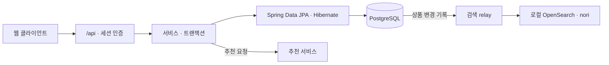

<div align="center">
  
  <h1>주점부리 · Backend</h1>
  <p>주점부리의 Spring Boot API</p>
  <a href="https://github.com/Pubburi/Backend/actions/workflows/ci.yml"></a>
    
</div>

<br />

## 📄 목차

- [프로젝트 개요](#overview)
- [현재 기능과 범위](#features)
- [기술 스택](#technology)
- [시스템 구조](#architecture)
- [문제 해결](#problem-solving)
- [로컬 실행](#development)
- [검증과 협업](#verification)
- [개발 계획](#roadmap)

<br />

<a id="overview"></a>

## ✍ 프로젝트 개요

고객은 주류를 검색하고, 취향에 맞는 상품을 찾거나 후기를 남깁니다. Backend는 상품과 계정 데이터를 관리하고, 데모 주문의 상품명과 가격을 주문 시점 그대로 보관합니다.

<a id="features"></a>

## 🥃 현재 기능과 범위

| 영역 | 현재 제공 기능 |
|---|---|
| 계정 | 회원가입·로그인·프로필 수정. 보호 요청마다 현재 계정과 역할을 확인합니다. |
| 찜·취향·기록 | 계정별 찜과 취향을 저장합니다. PostgreSQL에서는 마신 술이나 관심 있는 술을 비공개로 기록할 수 있습니다. |
| 상품·후기 | 이름과 주종으로 검색하고 가격·도수·맛·향으로 좁힙니다. 상세에서 용량·설명·출처와 회원 후기를 봅니다. |
| 추천 | 기본 목록(B0), 검수 상품의 취향 추천(B1), 유사 상품과 추천 이유를 제공합니다. 카트와 데모 주문도 추천에 쓸 수 있습니다. |
| 장바구니·주문 | PostgreSQL에서 기기 간 카트를 공유하고 비회원 카트를 병합합니다. 상품이나 회원을 삭제해도 주문 금액과 상세는 남습니다. |
| 관리자 | 상품·특성·회원·후기·매장·주문을 관리하고 데모 주문을 완료 처리합니다. |

기본 추천은 상품 ID순, 인기 상품은 누적 주문 수순입니다. 검수 카탈로그의 가격은 시연 값입니다. [API Map](docs/API-MAP.md)

<a id="technology"></a>

## ⚙️ 기술 스택

| 분류 | 기술 스택 |
|---|---|
| 언어 | Java · Python |
| 프레임워크·라이브러리 | Spring Boot · Bean Validation · Jackson |
| 서버 | Tomcat |
| 데이터베이스 | MySQL · PostgreSQL |
| 데이터 접근 | MyBatis · Spring Data JPA · Hibernate · PyMySQL · Psycopg |
| DB 마이그레이션 | Flyway |
| 검색 | OpenSearch · analysis-nori |
| API 문서 | springdoc · OpenAPI · Swagger UI |
| 빌드 | Maven Wrapper |
| 테스트 | JUnit |
| CI | GitHub Actions |

<a id="architecture"></a>

## 🏛️ 시스템 구조

기본 Maven JAR은 PostgreSQL과 JPA를 사용합니다. MySQL과 MyBatis 비교용 JAR은 별도로 빌드합니다.



검색은 기본적으로 DB에서 처리합니다. 별도로 실행한 relay가 상품 변경을 OpenSearch에 전송합니다. 엔진 검색을 켜면 API는 결과를 현재 DB와 대조하고, 누락이나 지연이 있거나 엔진에 연결할 수 없으면 같은 조건으로 DB를 조회합니다. [검색 계약](docs/PRODUCT-SEARCH.md) · [로컬 검색 실행](docs/LOCAL-SEARCH.md)

PostgreSQL로 옮길 때는 원본을 읽기 전용으로 추출하고, 승인한 자료만 빈 DB에 복사한 뒤 ID와 원문 JSON을 대조합니다. [전환 계약](docs/POSTGRESQL-MIGRATION.md)

<a id="problem-solving"></a>
<a id="case-studies"></a>

## 🧩 문제 해결

### 1. 상품 변경 기록의 원자성부터 검색 엔진 재전달까지 연결하기

#### 문제

검색 색인을 설계할 때 상품 변경은 저장됐지만 엔진에 보낼 기록이 남지 않는 경우를 막아야 했습니다. 삭제 전에 보낸 갱신이 늦게 도착하면 색인에 상품이 다시 나타날 수 있었습니다.

#### 원인

DB 커밋과 엔진 HTTP 전송은 따로 끝납니다. 상품을 지울 때 버전까지 없애면 늦게 들어온 갱신의 순서를 판단할 수 없습니다. 전역 자동 증가 ID도 상품 간 커밋 순서를 보장하지 않습니다.

#### 해결

상품 생성·수정·특성 교체·주문 수 증가·삭제 때 상품과 특성을 잠금 조회합니다. 같은 트랜잭션에서 상품별 버전, 색인할 데이터와 `PENDING` 전송 기록을 저장합니다. 삭제는 버전이 있는 표식으로 남깁니다. relay는 전송 권한을 DB에 기록하고 커밋한 뒤 엔진을 호출합니다. 응답을 받으면 DB 시각으로 유효 기간과 토큰을 다시 확인한 뒤 ACK합니다.

#### 결과

상품 변경과 전송 대기 기록은 함께 커밋되거나 롤백됩니다. relay를 다시 실행하면 미전송 작업을 이어받습니다. 중복이나 순서 역전은 상품별 버전과 엔진에 저장된 값을 대조하고, 원본이나 대상 색인의 식별자가 바뀌면 ACK를 거부합니다.

#### 대체안/회고

`afterCommit`에만 의존하면 DB 커밋 직후 프로세스가 멈췄을 때 전송 기록을 잃습니다. 업무 트랜잭션에서 엔진까지 호출하면 엔진 장애 동안 DB 잠금이 길어집니다. 이 사례에서는 전송 기록을 먼저 저장해 중복 전송을 허용하고, 상품별 버전으로 적용 여부를 판정했습니다. 원본과 물리 색인 UUID도 함께 확인합니다. 추가 조회와 쓰기가 생겼고 전후 지연은 측정하지 않았습니다.

#### 코드

```java
if (outbox.append(productId, version, deleted, json.writeValueAsString(event)) != 1)
    throw new IllegalStateException("Search outbox event could not be recorded");
if (outbox.schedule(productId, version) != 1)
    throw new IllegalStateException("Search delivery could not be scheduled");
```

```python
def ack(self, claim):
    with self.transaction() as cursor:
        self.fence_target(cursor, claim.fingerprint, claim.source_id)
        cursor.execute("""UPDATE t_product_search_delivery SET status='DELIVERED', delivered_at=NOW(6),
            claim_token=NULL, lease_until=NULL, last_error=NULL
            WHERE event_id=%s AND status='IN_FLIGHT' AND claim_token=%s AND lease_until>NOW(6)""",
            (claim.event_id, claim.token))
        return cursor.rowcount == 1
```


### 2. 같은 ID 재가입과 권한 변경에서 기존 세션을 구분하기

#### 문제

관리자 권한을 회수한 뒤에도 기존 쿠키로 관리자 API를 호출할 수 있었습니다. 삭제 전 쿠키로는 같은 ID로 재가입한 새 계정의 프로필도 열렸습니다.

#### 원인

인증 검사가 로그인 당시의 역할·이름·스탬프를 계속 사용했습니다. DB에서 ID만 확인하면 같은 ID로 재가입한 계정을 구분할 수 없습니다. 본인 정보 수정 뒤 계정 행을 다시 읽어 세션을 갱신하면, 그 사이 관리자가 바꾼 자격까지 이전 세션에 붙을 수 있었습니다.

#### 해결

가입할 때 `auth_epoch`를 발급하고 비밀번호를 직접 바꿀 때 새 값으로 교체했습니다. 보호 요청은 ID와 `auth_epoch`가 모두 일치하는 계정에서 현재 역할과 표시 정보를 읽습니다. 비밀번호 변경은 잠금 안에서 이전 값과 새 값을 함께 반환합니다. 요청이 사용한 세션이 이전 값과 일치할 때만 그 세션을 갱신합니다.

#### 결과

로컬 MySQL 8.4에 HTTP 요청을 보내 권한 강등, 계정 삭제, 같은 ID 재가입, 비밀번호 변경을 각각 전후 1회 확인했습니다. 이전 세션이 허용된 횟수는 모두 **1/1 → 0/1**이었습니다. 권한 강등은 403, 나머지는 401을 반환했고, 새 계정은 로그인할 수 있었습니다. 이름과 스탬프의 오래된 표시도 별도 시나리오에서 **1/1 → 0/1**이었습니다.

#### 대체안/회고

계정의 세션을 모두 찾아 지우려면 서버가 계정별 세션 목록을 관리해야 합니다. 계정의 버전을 비교하면 요청마다 DB를 한 번 읽습니다. 이미 인증을 통과한 요청은 계속 실행되며, DB 조회가 실패하면 인증을 보류하고 세션은 유지합니다. 일반 프로필 수정이나 해시 재계산은 `auth_epoch`를 바꾸지 않습니다. 분산 세션과 동시 요청의 지연은 측정하지 않았습니다.

#### 코드

```java
User current = userDao.selectSessionIdentity(observed.id(), observed.authEpoch());
if (!sameIdentity(value(session), observed)) {
	return null;
}
```

```java
synchronized (session) {
	if (sameIdentity(value(session), observed)) {
		if (!java.util.Objects.equals(updated.id(), observed.id())
				|| !java.util.Objects.equals(updated.previousAuthEpoch(), observed.authEpoch())) {
			session.removeAttribute(SESSION_USER);
		} else {
			session.setAttribute(SESSION_USER, new SessionUser(observed.id(), observed.name(),
					observed.stamps(), observed.role(), updated.authEpoch()));
		}
	}
}
```


### 3. 응답을 잃어도 장바구니와 주문의 중복 변경 막기

#### 문제

장바구니 병합 응답이 유실되는 상황을 개발 중 재현했습니다. 처리 기록이 404를 반환한 직후 원래 요청이 완료됐습니다. 새 요청 ID로 병합을 다시 보내자 수량이 2개에서 4개가 됐습니다.

#### 원인

404가 반환돼도 앞선 요청은 실행을 기다릴 수 있습니다. 새 요청이 최신 `revision`을 읽으면 버전 검사도 중복 합산을 막지 못합니다. 주문을 검증할 때는 bulk SQL 뒤의 `EntityManager.clear()`가 장바구니 엔티티를 분리해 주문만 저장되고 수량과 버전은 갱신되지 않는 경우도 발견했습니다.

#### 해결

계정 행을 잠그고 요청 UUID와 내용 해시로 처리 기록을 찾은 뒤 장바구니 버전을 검사합니다. 결과 확인 요청은 저장된 `APPLIED`를 읽거나, 처리 전인 UUID를 `RETIRED`로 저장해 나중에 같은 요청이 실행되지 않게 합니다. 주문과 수량 차감, 처리 기록은 같은 트랜잭션에 둡니다. 주문 SQL 뒤에는 장바구니를 다시 잠금 조회해 JPA가 관리하는 엔티티를 수정합니다.

#### 결과

격리된 PostgreSQL 18.6에 HTTP 요청을 보냈습니다. 먼저 폐기한 요청은 나중에 도착해도 409를 반환했고, 원래 요청이 먼저 끝나면 저장한 결과를 읽었습니다. 주문 응답을 잃어도 주문은 한 건만 생겼으며, 3개 중 2개를 주문하자 1개가 남았습니다. 처리 기록 저장을 실패시키면 주문·수량·버전이 함께 롤백됐습니다. 백업을 복구하고 JAR을 다시 띄운 뒤에도 `RETIRED`가 유지됐습니다.

#### 대체안/회고

버튼을 잠가도 다른 기기에서 다시 요청할 수 있습니다. 주문과 장바구니 차감을 별도 HTTP 요청으로 처리하면 하나만 성공할 수 있습니다. 두 변경을 한 트랜잭션에 두면 같은 계정의 쓰기는 순차로 처리되고, 처리 기록을 계정이 존재하는 동안 보관해야 합니다. 비회원 카트는 병합 결과를 확인할 때까지 기기에 남깁니다.

#### 코드

```java
@Transactional(isolation=Isolation.READ_COMMITTED)
public Result resolve(SessionUser owner, UUID operation, CartInput.Resolve input) {
    lockOwner(owner);
    String hash = CartInput.intent(input.items(), input.orderType(), input.orderTable());
    var receipt = matching(owner, operation, input.kind(), hash);
    if (receipt != null)
        return new Result(operation, true, receipt.status(),
            view(owner.id(), carts.findById(owner.id()).orElseThrow()), receipt.orderId());
    var cart = locked(owner);
    expected(cart, cart.version());
    advance(cart);
    operations.saveAndFlush(JpaCartOperation.retire(owner.id(), operation, input.kind(), hash));
    return new Result(operation, false, Status.RETIRED, view(owner.id(), cart), null);
}
```


### 4. 가격 변경·참조 삭제에서 주문 이력을 분리하기

#### 문제

상품 가격을 바꾸면 이미 완료한 주문의 금액이 달라졌습니다. 상품을 삭제하면 주문 상세가, 회원을 삭제하면 주문 자체가 사라질 수 있었습니다.

#### 원인

주문을 조회할 때 현재 상품의 가격을 조인했습니다. 상품과 회원을 가리키는 외래 키에는 `ON DELETE CASCADE`가 걸려 있었습니다. 가격을 따로 저장하더라도 상품 삭제로 상세 행이 지워지면 가격과 수량을 읽을 수 없습니다.

#### 해결

주문을 만들 때 `FOR UPDATE`로 상품을 읽고 상품명·단가·수량·합계와 주문 총액을 저장했습니다. 조회에는 저장한 값을 사용합니다. 새 주문은 `ORDER_SNAPSHOT`, 전환 시점의 값으로 보완한 과거 주문은 `LEGACY_ESTIMATE`로 표시합니다. 상품과 회원을 삭제할 때 외래 키는 `SET NULL`로 끊습니다. 회원 삭제 트랜잭션은 계정을 잠그고 자유 입력 메모를 정리한 뒤 계정을 지웁니다. 소유자가 없는 주문은 관리자만 조회합니다.

#### 결과

로컬에서 상품 가격을 바꿨을 때 기존 주문 금액이 달라진 건수는 **3/3 → 0/3**이었습니다. 같은 초기 데이터에서 상품 삭제 뒤 상세가 유실된 건수는 **2/3 → 0/3**, 이어 회원을 삭제한 뒤 주문이 유실된 건수는 **3/3 → 0/3**이었습니다. 삭제 후에도 주문 상세와 66,000원·217,800원·178,200원의 금액이 남았고 참조는 `null`이 됐습니다.

#### 대체안/회고

삭제 계정을 계속 보관하면 이름과 자격 정보를 남겨야 하고, 모든 조회에서 삭제 상태를 확인해야 합니다. 주문에는 그때 필요한 상품과 금액만 저장하고 계정 참조는 끊었습니다. MySQL 외래 키를 한 `ALTER`에서 제거하고 추가하자 1826 오류가 발생해 두 단계로 나눴습니다. 전환하려면 쓰기를 멈추고 백업한 뒤 중간 상태를 확인해야 합니다. 상품 잠금 조회와 회원 삭제의 동시성 비용은 측정하지 않았습니다.

#### 코드

```java
detail.setUnitPrice(product.getPrice());
try {
	detail.setSumPrice(Math.multiplyExact(product.getPrice(), detail.getQuantity()));
	totalPrice = Math.addExact(totalPrice, detail.getSumPrice());
	totalQuantity = Math.addExact(totalQuantity, detail.getQuantity());
} catch (ArithmeticException ex) {
	throw new IllegalArgumentException("Order amount or quantity is out of range", ex);
}
```

```sql
ALTER TABLE t_order_detail
    MODIFY COLUMN product_id INT NULL,
    ADD CONSTRAINT fk_order_history_product FOREIGN KEY (product_id)
        REFERENCES t_product(id) ON DELETE SET NULL;
```


<a id="development"></a>

## 🚀 로컬 실행

Java 17과 Docker Compose를 준비합니다. `./mvnw verify`로 PostgreSQL JAR을, `./mvnw -f tools/mysql-baseline/pom.xml verify`로 MySQL 비교용 JAR을 빌드합니다. 검증한 PostgreSQL을 실행 대상으로 선택한 뒤 `./scripts/dev.sh`로 Backend만 띄울 수 있습니다.

처음 웹과 추천 서버까지 띄울 때는 세 레포를 같은 상위 폴더에 두고 Backend에서 실행합니다. 통합 실행에는 Node.js 24, Python 3.12와 uv도 필요합니다. [통합 실행 안내](docs/LOCAL-DEVELOPMENT.md)

```bash
./scripts/local-stack.sh init
./scripts/local-stack.sh install
./scripts/local-stack.sh up
```

MySQL 비교 환경을 직접 띄우려면 `test -f .env || cp .env.example .env`로 설정 파일을 준비합니다. `.env`에 DB 이름, 사용자, 사용자와 root의 비밀번호, JDBC 주소를 채웁니다. macOS에서 다른 JDK를 쓰고 있다면 `export JAVA_HOME=$(/usr/libexec/java_home -v 17)`로 바꿉니다.

```bash
docker compose up -d db
./scripts/dev.sh --provider mysql
```

기본 포트는 9987입니다. [상품 API](http://localhost:9987/api/products) · [Swagger UI](http://localhost:9987/docs)

기존 DB에는 초기화 SQL을 다시 실행하지 않습니다. [주문 가격 스냅샷](docs/ORDER-PRICE-SNAPSHOT.md), [007 검색 변경 기록](docs/SEARCH-OUTBOX.md), [008 전송 예약](docs/SEARCH-RELAY.md)의 적용 상태를 확인합니다. `docker compose down`으로 종료하면 DB 볼륨은 남습니다.

<a id="verification"></a>

## ✅ 검증과 협업

```bash
./scripts/check.sh
```

폐기용 DB의 HTTP 검사 절차와 필수 검사 항목은 [테스트·CI 안내](docs/TESTING.md)에 있습니다.

최신 `main`을 반영한 PR에서 `backend-ci`가 성공하고 리뷰 대화가 모두 해결되면 squash merge합니다. 자동화 PR은 최신 커밋의 Codex 리뷰도 확인합니다. [협업 규칙](CONTRIBUTING.md)

<a id="roadmap"></a>

## 🗺️ 개발 계획

R01–R08·F01–F12 MVP의 목표는 **2026년 12월 31일**, 최종 인계는 **2027년 2월 5일**입니다. MVP 이후에는 오류와 성능을 측정해 개선합니다. [백엔드 개발 계획](docs/DELIVERY-PLAN.md)
