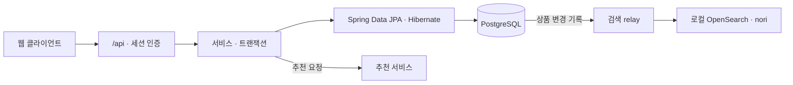

<div align="center">
  
  <h1>주점부리 · Backend</h1>
  <p>주점부리의 Spring Boot API</p>
  <a href="https://github.com/Pubburi/Backend/actions/workflows/ci.yml"></a>
    
</div>

<br />

## 📄 목차

- [프로젝트 개요](#overview)
- [현재 기능과 범위](#features)
- [기술 스택](#technology)
- [시스템 구조](#architecture)
- [문제 해결](#problem-solving)
- [로컬 실행](#development)
- [검증과 협업](#verification)
- [개발 계획](#roadmap)

<br />

<a id="overview"></a>

## ✍ 프로젝트 개요

고객은 주류를 검색하고, 취향에 맞는 상품을 찾거나 후기를 남깁니다. Backend는 상품과 계정 데이터를 관리하고, 데모 주문의 상품명과 가격을 주문 시점 그대로 보관합니다.

<a id="features"></a>

## 🥃 현재 기능과 범위

| 영역 | 현재 제공 기능 |
|---|---|
| 계정 | 회원가입·로그인·프로필 수정. 보호 요청마다 현재 계정과 역할을 확인합니다. |
| 찜·취향·기록 | 계정별 찜과 취향을 저장합니다. PostgreSQL에서는 마신 술이나 관심 있는 술을 비공개로 기록할 수 있습니다. |
| 상품·후기 | 이름과 주종으로 검색하고 가격·도수·맛·향으로 좁힙니다. 상세에서 용량·설명·출처와 회원 후기를 봅니다. |
| 추천 | 기본 목록(B0), 검수 상품의 취향 추천(B1), 유사 상품과 추천 이유를 제공합니다. 카트와 데모 주문도 추천에 쓸 수 있습니다. |
| 장바구니·주문 | PostgreSQL에서 기기 간 카트를 공유하고 비회원 카트를 병합합니다. 상품이나 회원을 삭제해도 주문 금액과 상세는 남습니다. |
| 관리자 | 상품·특성·회원·후기·매장·주문을 관리하고 데모 주문을 완료 처리합니다. |

기본 추천은 상품 ID순, 인기 상품은 누적 주문 수순입니다. 검수 카탈로그의 가격은 시연 값입니다. [API Map](docs/API-MAP.md)

<a id="technology"></a>

## ⚙️ 기술 스택

| 분류 | 기술 스택 |
|---|---|
| 언어 | Java · Python |
| 프레임워크·라이브러리 | Spring Boot · Bean Validation · Jackson |
| 서버 | Tomcat |
| 데이터베이스 | MySQL · PostgreSQL |
| 데이터 접근 | MyBatis · Spring Data JPA · Hibernate · PyMySQL · Psycopg |
| DB 마이그레이션 | Flyway |
| 검색 | OpenSearch · analysis-nori |
| API 문서 | springdoc · OpenAPI · Swagger UI |
| 빌드 | Maven Wrapper |
| 테스트 | JUnit |
| CI | GitHub Actions |

<a id="architecture"></a>

## 🏛️ 시스템 구조

기본 Maven JAR은 PostgreSQL과 JPA를 사용합니다. MySQL과 MyBatis 비교용 JAR은 별도로 빌드합니다.



검색은 기본적으로 DB에서 처리합니다. 별도로 실행한 relay가 상품 변경을 OpenSearch에 전송합니다. 엔진 검색을 켜면 API는 결과를 현재 DB와 대조하고, 누락이나 지연이 있거나 엔진에 연결할 수 없으면 같은 조건으로 DB를 조회합니다. [검색 계약](docs/PRODUCT-SEARCH.md) · [로컬 검색 실행](docs/LOCAL-SEARCH.md)

PostgreSQL로 옮길 때는 원본을 읽기 전용으로 추출하고, 승인한 자료만 빈 DB에 복사한 뒤 ID와 원문 JSON을 대조합니다. [전환 계약](docs/POSTGRESQL-MIGRATION.md)

<a id="problem-solving"></a>
<a id="case-studies"></a>

## 🧩 문제 해결

### 응답을 잃어도 장바구니와 주문의 중복 변경 막기

#### 문제

장바구니 병합 응답이 유실되는 상황을 개발 중 재현했습니다. 처리 기록이 404를 반환한 직후 원래 요청이 완료됐습니다. 새 요청 ID로 병합을 다시 보내자 수량이 2개에서 4개가 됐습니다.

#### 원인

404가 반환돼도 앞선 요청은 실행을 기다릴 수 있습니다. 새 요청이 최신 `revision`을 읽으면 버전 검사도 중복 합산을 막지 못합니다. 주문을 검증할 때는 bulk SQL 뒤의 `EntityManager.clear()`가 장바구니 엔티티를 분리해 주문만 저장되고 수량과 버전은 갱신되지 않는 경우도 발견했습니다.

#### 해결

계정 행을 잠그고 요청 UUID와 내용 해시로 처리 기록을 찾은 뒤 장바구니 버전을 검사합니다. 결과 확인 요청은 저장된 `APPLIED`를 읽거나, 처리 전인 UUID를 `RETIRED`로 저장해 나중에 같은 요청이 실행되지 않게 합니다. 주문과 수량 차감, 처리 기록은 같은 트랜잭션에 둡니다. 주문 SQL 뒤에는 장바구니를 다시 잠금 조회해 JPA가 관리하는 엔티티를 수정합니다.

#### 결과

격리된 PostgreSQL 18.6에 HTTP 요청을 보냈습니다. 먼저 폐기한 요청은 나중에 도착해도 409를 반환했고, 원래 요청이 먼저 끝나면 저장한 결과를 읽었습니다. 주문 응답을 잃어도 주문은 한 건만 생겼으며, 3개 중 2개를 주문하자 1개가 남았습니다. 처리 기록 저장을 실패시키면 주문·수량·버전이 함께 롤백됐습니다. 백업을 복구하고 JAR을 다시 띄운 뒤에도 `RETIRED`가 유지됐습니다.

#### 대체안/회고

버튼을 잠가도 다른 기기에서 다시 요청할 수 있습니다. 주문과 장바구니 차감을 별도 HTTP 요청으로 처리하면 하나만 성공할 수 있습니다. 두 변경을 한 트랜잭션에 두면 같은 계정의 쓰기는 순차로 처리되고, 처리 기록을 계정이 존재하는 동안 보관해야 합니다. 비회원 카트는 병합 결과를 확인할 때까지 기기에 남깁니다.

#### 코드

```java
@Transactional(isolation=Isolation.READ_COMMITTED)
public Result resolve(SessionUser owner, UUID operation, CartInput.Resolve input) {
    lockOwner(owner);
    String hash = CartInput.intent(input.items(), input.orderType(), input.orderTable());
    var receipt = matching(owner, operation, input.kind(), hash);
    if (receipt != null)
        return new Result(operation, true, receipt.status(),
            view(owner.id(), carts.findById(owner.id()).orElseThrow()), receipt.orderId());
    var cart = locked(owner);
    expected(cart, cart.version());
    advance(cart);
    operations.saveAndFlush(JpaCartOperation.retire(owner.id(), operation, input.kind(), hash));
    return new Result(operation, false, Status.RETIRED, view(owner.id(), cart), null);
}
```

<a id="development"></a>

## 🚀 로컬 실행

Java 17과 Docker Compose를 준비합니다. `./mvnw verify`로 PostgreSQL JAR을, `./mvnw -f tools/mysql-baseline/pom.xml verify`로 MySQL 비교용 JAR을 빌드합니다. 검증한 PostgreSQL을 실행 대상으로 선택한 뒤 `./scripts/dev.sh`로 Backend만 띄울 수 있습니다.

처음 웹과 추천 서버까지 띄울 때는 세 레포를 같은 상위 폴더에 두고 Backend에서 실행합니다. 통합 실행에는 Node.js 24, Python 3.12와 uv도 필요합니다. [통합 실행 안내](docs/LOCAL-DEVELOPMENT.md)

```bash
./scripts/local-stack.sh init
./scripts/local-stack.sh install
./scripts/local-stack.sh up
```

MySQL 비교 환경을 직접 띄우려면 `test -f .env || cp .env.example .env`로 설정 파일을 준비합니다. `.env`에 DB 이름, 사용자, 사용자와 root의 비밀번호, JDBC 주소를 채웁니다. macOS에서 다른 JDK를 쓰고 있다면 `export JAVA_HOME=$(/usr/libexec/java_home -v 17)`로 바꿉니다.

```bash
docker compose up -d db
./scripts/dev.sh --provider mysql
```

기본 포트는 9987입니다. [상품 API](http://localhost:9987/api/products) · [Swagger UI](http://localhost:9987/docs)

기존 DB에는 초기화 SQL을 다시 실행하지 않습니다. [주문 가격 스냅샷](docs/ORDER-PRICE-SNAPSHOT.md), [007 검색 변경 기록](docs/SEARCH-OUTBOX.md), [008 전송 예약](docs/SEARCH-RELAY.md)의 적용 상태를 확인합니다. `docker compose down`으로 종료하면 DB 볼륨은 남습니다.

<a id="verification"></a>

## ✅ 검증과 협업

```bash
./scripts/check.sh
```

폐기용 DB의 HTTP 검사 절차와 필수 검사 항목은 [테스트·CI 안내](docs/TESTING.md)에 있습니다.

최신 `main`을 반영한 PR에서 `backend-ci`가 성공하고 리뷰 대화가 모두 해결되면 squash merge합니다. 자동화 PR은 최신 커밋의 Codex 리뷰도 확인합니다. [협업 규칙](CONTRIBUTING.md)

<a id="roadmap"></a>

## 🗺️ 개발 계획

R01–R08·F01–F12 MVP의 목표는 **2026년 12월 31일**, 최종 인계는 **2027년 1월 15일(KST)**입니다. Notion의 기존 할 일을 모두 완료하면 곧바로 오류와 성능을 측정해 개선합니다. [백엔드 개발 계획](docs/DELIVERY-PLAN.md)
