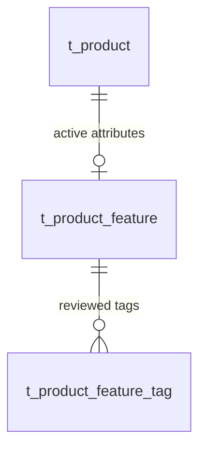

# 상품 특성 API·저장 계약

C03/BE04/F03의 **상품 특성 저장·조회 증가분**이다. 기존 상품의 8개 주종과
`id/name/type/price/img/abv/orderCount` 응답은 유지한다. 취향·찜·이벤트·검색 색인·추천 호출과
관리자 편집 화면 전체를 완료한 것은 아니다. 데이터 수집·특성 검수/학습·평가의 정본은
[Recommendation 계획](https://github.com/Pubburi/Recommendation/blob/main/docs/DATA-AND-MODEL-PLAN.md)이다.

## API

| 메서드·경로 | 인증 | 결과 |
|---|---|---|
| GET `/api/products/{id}/features` | 공개 | 현재 상품의 특성. 상품이 없으면 404 |
| PUT `/api/admin/products/{id}/features` | 현재 ADMIN 세션 | 특성 전체 교체 후 정규화된 특성. 상품이 없으면 404 |

기존 ApiResponse의 `data/message/error`를 사용한다. 유효한 비인증 PUT은 401, 활성 일반 회원은
403이다. BE03의 현재 계정/역할/자격 버전 검사를 그대로 따른다. [OpenAPI 3.1 명세](openapi/product-features.json)는
이 증가분의 계약이며 기존 API 전체를 새로 명세한 문서가 아니다.
명세는 [OpenAPI 3.1](https://spec.openapis.org/oas/v3.1.0)의 JSON Schema 기반 타입으로 nullable 값을 표현한다.

```json
{
  "data": {
    "productId": 123,
    "volumeMl": null,
    "description": null,
    "tasteTags": null,
    "aromaTags": null,
    "sourceName": null,
    "sourceUrl": null,
    "sourceNote": null
  },
  "message": "ok",
  "error": null
}
```

위 응답은 특성을 아직 확인하지 않은 **존재하는 상품**의 예시이며 123번 상품의 실재/속성을
주장하지 않는다. 기존 시드·새 상품 모두 별도의 검수 전에는 이 unknown 상태다. 가격·도수·
이름에서 맛/향·용량을 추정하지 않고 0/빈 배열로 누락을 덮지 않는다.

| 필드 | 값·제약 |
|---|---|
| productId | 응답에만 존재. 경로의 실제 상품 ID |
| volumeMl | 미확인 null, 또는 JSON 정수 1–1,000,000mL. 소수·문자열·0 거부 |
| description | 미확인 null, 최대 2,000자. 앞뒤 공백 제거, 공백뿐이면 null |
| tasteTags/aromaTags | 미확인 null. 검수했지만 선언할 태그가 없으면 []. 종류별 최대 20개·각 40자 |
| sourceName | 최대 200자. 확인한 값이나 non-null 태그 배열(빈 배열 포함)이 있으면 필수 |
| sourceUrl | 최대 1,000자. 선택적 absolute HTTP(S) URL, userinfo 불허. 서버가 URL을 요청하지 않음 |
| sourceNote | 최대 1,000자. 선택적 출처 범위·검수 메모. 응답에 공개됨 |

태그는 앞뒤 공백 제거·Locale.ROOT 소문자화·오름차순으로 저장/반환한다. null 항목·공백 항목과
정규화 뒤 중복(`SWEET`/` sweet `)은 거부한다. 길이는 정규화 뒤에도 확인한다. 동의어 합치기·
맛 강도 추정·고정 주종별 맛 부여는 수행하지 않는다. 1백만mL는 대용량도 수용하는 저장 기술
상한이며 표준 병 용량이나 확인된 상품 사실을 뜻하지 않는다.
태그 항목과 설명/출처는 실제 JSON 문자열만 받는다. 숫자·boolean을 문자열 태그나 출처로
자동 변환하지 않는다. null 태그 항목·객체·중첩 배열도 400으로 거부한다.

**PUT은 전체 교체다.** 빠뜨리거나 null로 보낸 필드는 unknown이 되고 `{}`는 모든 특성과 출처를
지운다. `{"tasteTags":[],"sourceName":"검수 근거"}`는 맛 태그를 확인했으나 선언하지 않았다는
상태이며 aromaTags는 unknown이다. 반복한 동일 PUT은 같은 상태를 유지한다. 별도 revision/ETag
충돌 검사는 이번 증가분에 없으므로 두 관리자가 동시에 수정하면 잠금 순서의 마지막 교체가 남는다.

Bean Validation 실패와 JSON 타입/형식 오류는 400 `VALIDATION_FAILED`, 정규화 후 중복 태그는
400 `BAD_REQUEST`다. 실패 입력이 기존 저장 특성을 부분적으로 바꾸지 않아야 한다.

## 출처와 권리의 구분

sourceName/URL/note는 이 특성 묶음을 어디에서 확인했는지 기록하는 필드다. 라이선스·학습·
재배포·이미지 권리의 승인 상태를 뜻하지 않는다. 값이 있다는 이유로 수집/학습을 자동 허용하지
않는다. 원천별 상세 감사·필드 근거·공개/학습 가능 여부는 Recommendation 소유 기록에서 확인한다.
출처가 여러 개면 해당 필드 범위를 sourceNote에 명시하며 필드별 원문 증거/라이선스 관리를
이 한 문자열로 대체하지 않는다. API는 URL fetch·크롤링·자동 검수·카탈로그 모델 fit을 수행하지 않는다.

단위/HTTP 검증의 Fixture·가상 태그·가상 용량은 기술 검증용 합성 입력으로, 실제 주류의 속성이나
수집/학습 완료 성과로 사용하지 않는다. sourceNote는 공개 응답이므로 인증값·개인 설정을 넣지 않는다.

## 관계·트랜잭션



헤더는 nullable 용량/설명/출처와 taste_known/aroma_known을 저장한다. 태그는
`(product_id, kind, tag)` 기본 키로 분리하고 이진 collation을 사용해 소문자화 이후 다른 악센트/문자를
DB collation이 임의로 합치지 않게 한다. null과 []의 차이는 known 플래그로 복구한다.

쓰기 순서는 현재 상품 `FOR UPDATE` → 헤더 upsert → 이전 태그 삭제 → 새 태그 일괄 삽입이다.
같은 상품의 수정/삭제와 직렬화하고 태그 쓰기 실패는 같은 서비스 트랜잭션으로 rollback한다.
같은 값의 헤더 upsert는 MySQL affected-row 설정에 따라 0을 반환할 수 있어 0만으로 실패라고
판정하지 않는다. DB 예외는 성공으로 바꾸지 않는다. 읽기는 read-only 트랜잭션에서 헤더/태그를
조립하며 없는 특성 행도 현재 상품 LEFT JOIN으로 unknown을 반환한다.
[MySQL 8.4 upsert의 행 별칭·영향 행 수](https://dev.mysql.com/doc/refman/8.4/en/insert-on-duplicate.html)를 기준으로 구현했다.

상품 삭제는 활성 특성/태그를 CASCADE로 제거한다. BE01/BE02의 주문 상품명·단가/합계 스냅샷과
nullable 상품 참조는 별도 관계이므로 삭제 후 업무 이력은 보존한다. 이번에 주문 스냅샷에 맛/향·
출처를 추가하지 않으며 과거 주문의 특성을 소급 보장하지 않는다.

## 수동 004 전환

새 폐기 DB는 현재 data.sql을 사용한다. 기존 DB는 001→002→003 적용 상태와 원본 백업·복구를
확인한 뒤 쓰기를 멈추고 [004](migrations/004-product-features.sql)를 수동 적용한다. 두 새 테이블만
만들며 기존 상품/회원/주문/상세를 UPDATE하거나 검수하지 않은 특성을 채우지 않는다.

1. 적용 전후 기존 행 수와 내부 업무 필드 digest를 비교한다. hash/실제 epoch/개인정보를 공개하지 않는다.
2. feature/tag 테이블 0행과 FK·CHECK를 확인하고 새 서버를 시작한다. 기존 상품 GET은 모두unknown이어야 한다.
3. DDL은 암시적 commit이다. 부분 실패는 현재 테이블/제약을 확인해 백업 복구 또는 검토한 나머지
   CREATE를 실행한다. 파일은 자동 멱등이 아니고 전체 재실행은 첫 table-exists 오류에서 중단한다.
4. 오류를 `--force`로 넘기거나 기존 DB에 data.sql을 재실행하지 않는다. 앱 시작 시 자동 전환하지 않는다.
5. 기능 사용 후 되돌려야 하면 특성을 먼저 별도 백업한다. 두 테이블을 무작정 제거하면 입력한 특성을
   잃으므로 테이블 제거는 기본 로컬 시작/종료 경로에 포함하지 않는다.

검증은 [TESTING](TESTING.md)의 전용 폐기 컨테이너/DB/marker를 사용한다. 기존 로컬 볼륨과 공유
포트를 건드리지 않는다. 이 증가분은 응답 지연/추천 품질 개선을 주장하지 않는다.

## 런타임 문서 경로

실제 jar의 `/v3/api-docs`와 `/docs`도 필수 readonly smoke에서 확인한다. 기존 springdoc 2.2.0은
현재 Boot 3.5.0에서 ControllerAdviceBean 생성자 연결 오류로 문서 HTTP 500을 일으켰다.
[공식 v2 호환 표](https://springdoc.org/v2/#what-is-the-compatibility-matrix-of-springdoc-openapi-with-spring-boot)는
Boot 3.1과 2.2.x, Boot 3.5와 2.8.x–2.10.x를 대응한다. 다만 실제 Boot 3.5.0에서는 2.10.0의
Swagger 리소스 패턴 조합이 기동에 실패했고 2.8.17도 DB 없는 전체 MVC context에서 같은 실패를 보였다.
[2.8.9 공식 릴리스](https://github.com/springdoc/springdoc-openapi/releases/tag/v2.8.9)는 Boot 3.5.0
API 지원/빌드를 명시하며 해당 버전에서 문서 생성/Swagger MVC 회귀를 확인해 고정했다.
전역 경로 matcher·기존 업무 라우팅을 바꾸지 않고, 호환 표만으로 실제 기동 성공을 추정하지 않는다.
문서 회귀는 새 GET/PUT 경로·응답 8/요청 7필드·nullable 값·Swagger UI 진입 HTML을 실제 HTTP로
검사한다. 정적 명세 파일이 있다는 사실만으로 런타임 OpenAPI 생성 성공을 대신하지 않는다.
새 경로의 JSON produces/PUT consumes를 명시해 런타임 문서의 media도 실제 JSON과 맞춘다.
기본 OpenAPI 3.1의 null은 Schema.types의 union으로 선언하며, 과거 nullable 플래그만을 확인하지 않는다.
